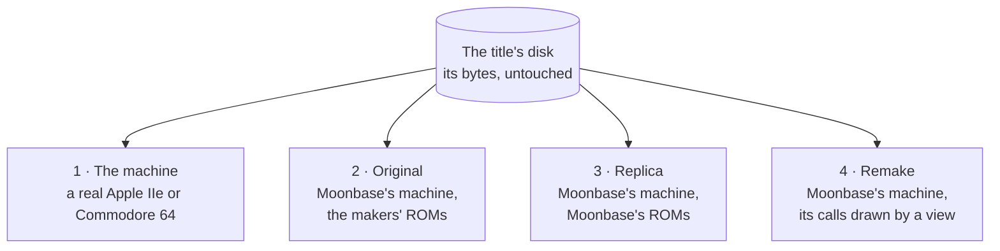
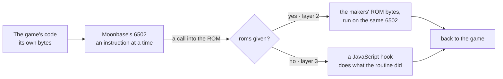
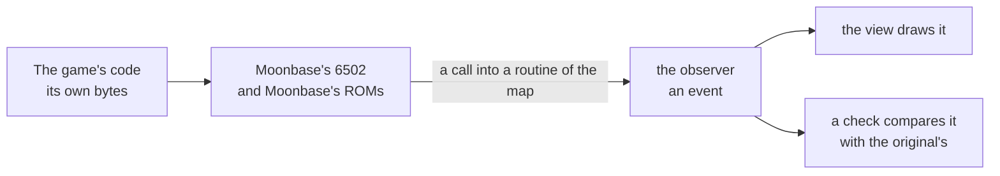

# The four layers

A title can run four ways. The first is the real machine. The other three are Moonbase's. In every layer the
game's own code runs. What changes is what answers its calls into the ROM, and what draws its screen. Before
the layers, here is what the machine was.

## The machine

The Apple IIe and the Commodore 64 had no operating system as we'd mean one now. Each had a ROM of routines at
fixed addresses and BASIC, and that was all.

- **The ROM.** The Apple's Monitor (character out at `$FDED`, a key, a delay, the bell) and Applesoft, or the
  Commodore 64's KERNAL, reached through its jump table at `$FFxx` (character out at `$FFD2`, a key, load, save),
  and its BASIC V2. A program called a routine with `JSR` to its address.
- **BASIC was the shell.** Switch the Commodore 64 on and it says READY. The Apple starts its disk drive and
  boots the disk in it; with no disk there, Control-Reset gives Applesoft's prompt.
- **The disk system wasn't in the machine.** On the Apple, DOS 3.3 or ProDOS was loaded from the disk into
  ordinary RAM. ProDOS left one entry point, `$BF00`, and DOS 3.3 took its commands by watching the characters a
  program printed, a Control-D first. On the Commodore 64, the DOS was inside the 1541 drive, which has its own
  6502 and ROM, and the computer talked to it over a serial cable.
- **Nothing was protected.** The 6502 has no supervisor mode, no memory protection and no processes. A program
  could write to any address, including the screen and the hardware's registers (the Apple's switches at `$C0xx`,
  the Commodore 64's video and sound chips at `$D000`), replace the interrupt vectors, switch the ROM out to use
  the RAM under it, or leave BASIC and the ROM behind entirely.

That's why the layers work. With nothing between the game and the hardware, a game meets the machine in only
three ways: the 6502 itself, the memory and I/O addresses it reads and writes, and the ROM routines it calls at
known addresses. Moonbase can stand in for each of them.

## The four layers

| Layer | Name | The game's code runs on | The ROM and the disk system are |
|---|---|---|---|
| 1 | The machine | a real 6502 | the real chips |
| 2 | **Original** | Moonbase's 6502, an instruction at a time | Apple's or Commodore's own ROM bytes, run on that 6502 |
| 3 | **Replica** | the same 6502, the same way | JavaScript, answering each call at its address |
| 4 | **Remake** | the same 6502, the same way, with a view that draws the game's calls | the same JavaScript |

The player plays layers 2, 3 and 4 (`@moonbase-machines/player`, `play()`). The way `original` is layer 2
when the page gives it the makers' ROMs (`roms`) and layer 3 when it doesn't. The way `remake` is layer 4.

## Layers 2 and 3: one machine, two kinds of ROM

The Original and the Replica are the same machine. Both use the same `Machine` class (`apple2e/machine.js`, or
`c64/machine.js` for the Commodore 64) and the same 6502 (`mos6502/cpu.js`). The game's own bytes run on it
an instruction at a time in both. The only difference is what's at the ROM's addresses.

**Layer 2, the Original.** The machine is given Apple's or Commodore's ROMs and starts at the reset vector,
as the real one did. On the Apple IIe, the Disk II card is emulated and its ROM boots the disk image, as a
school's Apple did. On the Commodore 64, Commodore's KERNAL and BASIC run, and `LOAD"…",8,1` is typed for the
game. The packages don't include the makers' ROMs, so the page supplies them where it has them.

**Layer 3, the Replica.** There are no ROM bytes. The CPU has hooks (`cpu.hooks`): when the program counter
reaches an address the machine has taken over, a JavaScript function runs in its place and the CPU returns
as if from a subroutine. Each function takes what the ROM routine took, in the registers and zero page, and
leaves what it left.

- On the Apple IIe, the Monitor's and Applesoft's routines the games call are in `apple2e/rom.js`. ProDOS's
  calls at `$BF00` are answered from the disk's files (`apple2e/mli.js`). Nothing boots: a ProDOS game's
  system file is put at `$2000` and run, and a DOS 3.3 game's files are loaded where its BASIC program put
  them, and its `CALL` is made.
- On the Commodore 64, the machine still starts at the reset vector and the same `LOAD` is typed, but the
  KERNAL and BASIC are answered in `c64/kernal.js`, `c64/basic-rom.js` and `c64/rom.js`. The ROM images hold
  only the few bytes the games read as data, and the characters are Moonbase's own
  (`@moonbase-machines/charset`).

A routine with no answer stops the machine and says where. Nothing of Apple's or Commodore's is needed.

On the Commodore 64, the 1541 is JavaScript on both layers (`c64/drive.js`). It's answered at the KERNAL's
serial bus routines rather than run as a processor of its own.

## Layer 4: the Remake

The Remake runs the game's own code on the Replica's machine: Moonbase's 6502 and Moonbase's ROMs. What it
changes is what the player sees. A title's map names the routines its code calls, by address. The observer
(`player/remake/observer.js`) sets a hook at each of those addresses, and every call becomes an event. A view
draws the events in place of the machine's screen, and the pilots read the same events as a transcript to hold
against the original's.

How the Remake shows the game depends on the title:

- **A title made with a toolkit** brings the toolkit in its driver, its `title.js`, and the toolkit's view draws the game. A
  vector title brings the vector toolkit (`@moonbase-machines/vector`), which draws its pictures from their shapes as
  SVG, at any size, and its words in a modern face. The player's own code names no toolkit.
- **A title with no toolkit** on the Apple IIe has the machine's own screen, the hi-res page dot for dot, with its
  words painted again in one colour where the title says how to find them.
- **A Commodore 64 title** is the 64 itself, on Moonbase's ROMs, with no view of its own. Its Remake can have the
  game's bugs fixed: the fixes are made to its program on the disk.
- **A title of its own engine** has no machine. Its program's engine is written again routine for routine, and
  plays the game's data as the original read it.

The machine counts the game's time in cycles, as on layer 3. The Remake's clock can also warp: a title says which of
its routines the machine runs through flat out, as a vector title's drawing, since a view draws at once.

`player/remake/README.md` says how the Remake runs the game, what the map holds, and how the views draw it.

### One answer for the Replica and the Remake

The Remake runs on the Replica's machine, so each ROM routine a title calls is written once, in JavaScript, and
both layers 3 and 4 use that one function. It is installed on the emulated 6502's hooks (`cpu.hooks`): when the
program counter reaches the routine's address, the function runs in its place.

Some examples:

- **COUT, `$FDED`, the Apple's character out.** `apple2e/rom.js` has `0xfded: () => cout(c.a)`. It takes the
  character from A, puts it on the text screen at the cursor, and leaves the cursor and registers as Apple's
  ROM would. The game's `JSR $FDED` reaches the hook.
- **WAIT, `$FCA8`, the Apple's delay.** The function adds to `cycles` the time the ROM's loop took for the
  value in A, and the machine's clock moves on by that much. So a pause lasts as long as it did on Apple's ROM.
- **CHROUT, `$FFD2`, the Commodore 64's character out.** `c64/kernal.js` sends the character to the screen,
  or to the drive or the printer when output has been redirected to a device on the bus. `c64/rom.js` installs
  it, calling `kernal.js`'s `install()` with the machine's processor.
- **ProDOS, `$BF00`, the Apple's files.** `mli()` reads the call number and the parameters' address from the
  three bytes after the game's `JSR $BF00`, then calls `files.call()` (`Files` in `apple2e/mli.js`). It reads
  the files from the disk, and adds a disk's time for each 512-byte block read.

Because there's one copy, a fix to COUT or to the KERNAL's LOAD fixes both layers. Layer 3 is checked against
layer 2, the makers' own ROMs, so the Remake's routines are checked by that too. When the Remake and the
Original differ, the difference is in Moonbase's ROMs, the title's map or the observer, never in a second copy of
the game.

## What each layer is for

- **Layer 1** is the reference: what the game really did.
- **Layer 2** is the closest to layer 1 that a browser gets. It needs the makers' ROMs, so it's for a machine
  that has them.
- **Layer 3** runs the original program as it is, on nothing but Moonbase's code. Running it against layer 2
  shows that Moonbase's ROM answers do what the makers' ROMs did.
- **Layer 4** is the game made new to look at. Because it runs the original's own code, its events can be
  compared with the original's, step for step, and a bug can be fixed at a known address.
